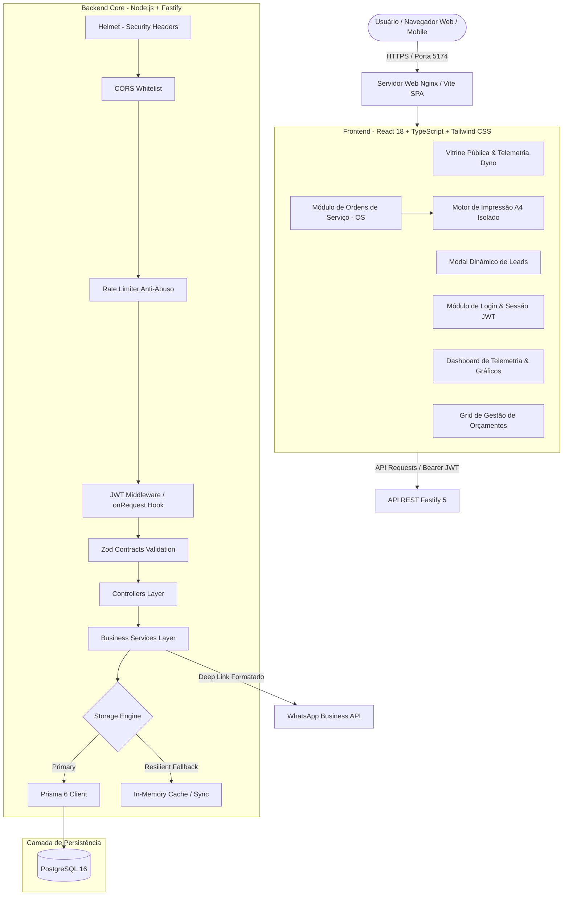

# 🏁 63 Motorsport | Workshop & Dyno Telemetry Management Platform

<div align="center">


[](https://react.dev/)
[](https://www.typescriptlang.org/)
[](https://nodejs.org/)
[](https://fastify.dev/)
[](https://tailwindcss.com/)
[](https://www.prisma.io/)
[](https://www.postgresql.org/)
[](https://www.docker.com/)

Plataforma full-stack corporativa de **apresentação institucional, telemetria de dinamômetro 4x4, captação de leads e gestão operacional de Ordens de Serviço (OS)** projetada sob medida para a oficina de alta performance **63 Motorsport**.

[Explorar Demonstração](#-acesso-rápido--demonstração) • [Arquitetura](#-arquitetura-do-sistema) • [Destaques Técnicos](#-diferenciais-de-engenharia-para-recrutadores) • [Módulos do Sistema](#-módulos-da-aplicação) • [Guia de Execução](#-guia-de-execução-local)

</div>

---

## 📌 Visão Geral do Projeto

A **63 Motorsport** é uma oficina especializada em engenharia automotiva, calibração customizada de injeções (Stage 1 a 3), montagem de blocos forjados e telemetria em dinamômetro 4x4 Servitec.

Este sistema resolve integralmente as duas pontas da operação:
1. **Front-facing (Conversão de Clientes):** Landing page de altíssima fidelidade estética automobilística, 100% responsiva para celulares, demonstrando projetos reais com telemetria (WHP, torque, ganho de potência) e modal dinâmico de orçamento com redirecionamento inteligente para WhatsApp.
2. **Back-office (Gestão Operacional & Telemetria):** Painel administrativo protegido por autenticação JWT, contendo telemetria de tráfego e conversão, pipeline de orçamentos e um **módulo completo de Ordens de Serviço (OS)** com cálculo em tempo real de mão de obra/peças e **motor de geração de PDF A4 isolado para impressão**.

---

## 💡 Diferenciais de Engenharia (Para Recrutadores & Tech Leads)

- **Tipagem Estrita de Ponta a Ponta (End-to-End TypeScript):** Contratos de dados compartilhados entre schemas Zod na borda da API, modelos relacionais do Prisma e componentes React tipados sem uso de `any`.
- **Arquitetura de Segurança Defensiva (Defense in Depth):**
  - Autenticação stateless baseada em **JWT (`@fastify/jwt`)** com rota protegida por hooks de ciclo de vida Fastify.
  - Cabeçalhos de segurança HTTP com **Helmet** (`X-Frame-Options`, `nosniff`, `XSS-Protection`).
  - **Rate Limiting em duas camadas:** Proteção global contra brute force e DDoS (`@fastify/rate-limit`) e limite restrito para submissão de leads.
  - **CORS dinâmico:** Controle estrito de origens permitidas via variável de ambiente.
  - Execução de contêiner com usuário sem privilégios (`USER node`) no Dockerfile de produção.
- **Padrão de Resiliência Dual-Storage (Zero Downtime / Offline-First):**
  - O backend e frontend contam com arquitetura híbrida de armazenamento: utilizam PostgreSQL via Prisma quando disponível, mas alternam de forma transparente e reativa para um store persistente em memória e `localStorage` caso o banco relacional esteja em manutenção ou durante demonstrações em redes remotas. Nenhuma ação do usuário é perdida.
- **Motor de Impressão Isolada de OS (Isolated DOM Print Engine):**
  - Solução de engenharia para o problema clássico de `window.print()` em Single Page Applications (onde o DOM de fundo com tabelas e menus vaza na impressão).
  - Implementação de um gerador virtual em sandbox (`printIsolatedOrder`) com regras estritas `@media print`, garantindo que **apenas e estritamente a folha da OS do cliente selecionado** seja impressa em formato vetorial A4 de alta definição.
- **Ergonomia e Design System Automobilístico:**
  - Paleta baseada na cultura de motorsport: *Asphalt Black (`#090A0D`)*, *Carbon Graphite (`#13151A`)*, *Gunmetal Gray (`#262933`)*, *Pure Titanium White (`#FFFFFF`)* e detalhes funcionais em *Tachometer Red (`#EF4444`)*.
  - Grid responsivo que se adapta perfeitamente de monitores ultrawide a smartphones compactos (360px) sem nenhum overflow horizontal.

---

## 🏗 Arquitetura do Sistema



---

## 🏎 Módulos da Aplicação

### 1. Vitrine Pública (Landing Page)
* **Hero Técnico:** Apresentação institucional com instrumentação esportiva e dados em tempo real do dinamômetro Servitec 4x4.
* **Projetos de Alta Performance:** Cards dinâmicos comparando potência original vs aferida (ex: *Golf GTI MK7 330 WHP*, *BMW M2 Competition 585 WHP*), pressão de turbo, curvas de torque e lista de mods.
* **Catálogo de Serviços:** Apresentação detalhada das categorias (Remap Stage 1, Stage 2, Stage 3, Dinamômetro 4x4, Motores Forjados e Manutenção Preventiva).
* **Conversão Imediata:** Botões flutuantes e modais que preparam a mensagem personalizada do veículo e serviço para atendimento direto no WhatsApp.

### 2. Autenticação Administrativa (`/admin`)
* Tela de login temática com atmosfera de box de corrida.
* Token JWT criptografado com validade de 7 dias e renovação automática.
* **Atalho "Acesso Rápido Demo":** Preenchimento com 1 clique para agilizar a avaliação técnica por recrutadores.

### 3. Dashboard de Telemetria & Métricas
* **4 KPIs Principais:** Total de orçamentos, pipeline financeiro estimado (R$), taxa de conversão do tráfego e volume de acessos.
* **Gráfico Semanal de Acessos:** Gráfico interativo com destaque para os picos de busca pré-track day (sextas e sábados).
* **Distribuição de Serviços:** Barras de progresso proporcionais dos serviços mais procurados.
* **Exportação CSV:** Download instantâneo de relatórios dos leads para análise em planilhas.

### 4. Grid de Orçamentos & Leads
* **Busca em Tempo Real:** Pesquisa instantânea por nome do cliente, modelo do veículo, telefone ou serviço.
* **Filtros por Pipeline:** Abas para alternar entre *Todos, Pendentes, Contatados, Agendados, Concluídos* e *Cancelados*.
* **Visualização Híbrida:** Tabela técnica para desktop e cards em formato de prancheta de oficina para celulares.
* **Conversão 1-Toque para OS:** Botão **"Gerar OS"** que transfere os dados do cliente e do veículo direto para a abertura de uma nova ordem de serviço.
* **Atendimento WhatsApp Direto:** Botão individual que abre o WhatsApp com saudação técnica contendo o nome do cliente e veículo.

### 5. Módulo de Ordens de Serviço (OS) & Gerador de PDF
* **Cadastro Completo:**
  - Dados do Cliente (Nome, CPF/CNPJ, Telefone, E-mail, Cidade, Endereço).
  - Dados do Veículo (Modelo, Marca, Placa Mercosul, Ano, Km de entrada, Combustível, Setup atual).
* **Gerenciador de Itens Dinâmico:**
  - Inclusão ilimitada de **Serviços** (mão de obra) e **Peças / Insumos Racing** com quantidade, valor unitário e total calculado automaticamente.
  - Subtotais separados, campo para desconto comercial pontual e valor total líquido.
* **Registro de Telemetria de Dinamômetro:**
  - Registro de ganho de potência (WHP Original vs Calibrado) com cálculo percentual.
  - Torque inicial vs final (kgfm), pressão de turbo (bar) e identificação do preparador técnico.
* **Impressão & PDF Oficial A4:**
  - Layout formal com cabeçalho da oficina, CNPJ, dados de contato e número sequencial da OS (ex: `#OS-2026-0042`).
  - Termo oficial de garantia mecânica e calibração eletrônica da 63 Motorsport.
  - Linhas formais para assinatura do Preparador Responsável e do Proprietário do Veículo.
  - **Botão "Imprimir / Salvar PDF"** gerando documento vetorial A4 sem vazamento de telas de fundo.

---

## 🛠 Stack Tecnológica e Decisões de Arquitetura

| Camada | Tecnologia | Justificativa Técnica |
| :--- | :--- | :--- |
| **Frontend Framework** | **React 18** | Renderização declarativa, hooks modernos (`useState`, `useEffect`, `useCallback`) e suporte a Suspense. |
| **Linguagem (Full Stack)** | **TypeScript 5.7** | Tipagem estrita com `noImplicitAny`, prevenindo falhas de runtime e documentando contratos de código. |
| **Build Tool** | **Vite 6** | Compilação ultrarrápida com Rollup, HMR instantâneo e geração de bundles otimizados com code-splitting. |
| **Estilização** | **Tailwind CSS 3.4** | Utility-first CSS com zero runtime overhead, classes atômicas e design tokens customizados para motorsport. |
| **Ícones** | **Lucide React** | Biblioteca vetorial leve, limpa e modular. |
| **Backend Framework** | **Fastify 5** | Um dos frameworks Node.js mais rápidos do mundo, arquitetura baseada em plugins e baixo consumo de memória. |
| **Autenticação** | **@fastify/jwt** | Autenticação stateless baseada em tokens HMAC-SHA256 sem necessidade de consultas a sessões em disco. |
| **Segurança** | **Helmet + CORS + RateLimit** | Conjunto completo de mitigação de ataques web modernos (XSS, Clickjacking, Brute Force). |
| **Validação** | **Zod 3.24** | Parsing declarativo e tipado na fronteira de entrada da API. |
| **ORM & Banco** | **Prisma 6 + PostgreSQL 16** | Mapeamento objeto-relacional com migrações declarativas e pool de conexões otimizado. |
| **DevOps / Containers** | **Docker & Docker Compose** | Ambientes reproduzíveis e conteinerização multi-stage para desenvolvimento e produção. |

---

## 📖 Documentação da API REST

Todas as rotas administrativas exigem o envio do token no cabeçalho: `Authorization: Bearer <TOKEN_JWT>`.

| Método | Endpoint | Acesso | Descrição |
| :---: | :--- | :---: | :--- |
| `GET` | `/health` | Público | Healthcheck com uptime, status do serviço e diagnóstico do banco. |
| `POST` | `/api/v1/auth/login` | Público | Autenticação do operador. Retorna token JWT e perfil do usuário. |
| `GET` | `/api/v1/auth/me` | Protegido | Valida a validade do token JWT ativo. |
| `GET` | `/api/v1/projects` | Público | Lista projetos de preparação com telemetria para a vitrine pública. |
| `POST` | `/api/v1/quotes` | Rate Limit | Registra orçamento solicitado pelo cliente e gera deep link do WhatsApp. |
| `GET` | `/api/v1/admin/dashboard` | Protegido | Retorna KPIs, gráfico semanal de acessos e distribuição de serviços. |
| `GET` | `/api/v1/admin/quotes` | Protegido | Lista orçamentos com suporte a filtros por status e busca textual. |
| `PATCH`| `/api/v1/admin/quotes/:id/status`| Protegido | Atualiza o status do lead (`PENDING`, `CONTACTED`, `SCHEDULED`, `COMPLETED`, `CANCELLED`). |
| `DELETE`| `/api/v1/admin/quotes/:id` | Protegido | Remove um orçamento arquivado. |
| `GET` | `/api/v1/admin/orders` | Protegido | Lista ordens de serviço (OS) com busca e filtros por status. |
| `GET` | `/api/v1/admin/orders/:id` | Protegido | Retorna os detalhes completos de uma OS individual. |
| `POST` | `/api/v1/admin/orders` | Protegido | Cria uma nova Ordem de Serviço com itens, valores e telemetria. |
| `PUT` | `/api/v1/admin/orders/:id` | Protegido | Atualiza itens, dados cadastrais ou status da Ordem de Serviço. |
| `DELETE`| `/api/v1/admin/orders/:id` | Protegido | Exclui uma Ordem de Serviço do sistema. |

---

## 🔑 Acesso Rápido & Demonstração

Para avaliar a plataforma imediatamente sem necessidade de cadastro prévio:

- **E-mail de Operador:** `admin@63motorsport.com.br`
- **Senha:** `admin123`
*(Na tela de login, basta clicar no botão **"Acesso Rápido Demo"** para preencher tudo automaticamente).*

---

## ⚡ Guia de Execução Local

### Pré-requisitos
- **Node.js** (v20+ instalado)
- **npm** (v10+ instalado)
- *Opcional:* Docker & Docker Compose (para banco de dados relacional local)

### 1. Clonar o Repositório
```bash
git clone https://github.com/gabrielLemke/63Motorsport.git
cd 63Motorsport
```

### 2. Configurar Variáveis de Ambiente
Copie os templates pré-configurados:
```bash
cp .env.example .env
cp backend/.env.example backend/.env
```

### 3. Executar o Backend (Fastify)
```bash
cd backend
npm install
npm run dev
```
O servidor da API iniciará em: `http://localhost:3334`.
*(Verifique a saúde da aplicação em `http://localhost:3334/health`).*

### 4. Executar o Frontend (React + Vite)
Em outro terminal:
```bash
cd frontend
npm install
npm run dev
```
A aplicação abrirá em: `http://localhost:5174` (ou `http://localhost:5173`).

---

## 🐳 Execução via Docker (Ambiente Completo)

Para subir o banco de dados PostgreSQL, a API Fastify e o Frontend com apenas um comando:

```bash
docker compose up -d
```

---

## 📁 Estrutura de Pastas do Projeto

```text
63Motorsport/
├── backend/
│   ├── prisma/                       # Schema relacional PostgreSQL e seeds
│   │   ├── schema.prisma
│   │   └── seed.ts
│   ├── src/
│   │   ├── controllers/              # Controladores de rotas
│   │   │   ├── admin.controller.ts
│   │   │   ├── auth.controller.ts
│   │   │   ├── health.controller.ts
│   │   │   ├── project.controller.ts
│   │   │   ├── quote.controller.ts
│   │   │   └── service-order.controller.ts
│   │   ├── routes/                   # Definição e agrupamento de endpoints
│   │   ├── schemas/                  # Contratos de validação Zod
│   │   ├── services/                 # Lógica de negócio e store resiliente
│   │   ├── app.ts                    # Configuração de plugins (CORS, JWT, Helmet)
│   │   └── server.ts                 # Inicialização HTTP com graceful shutdown
│   ├── Dockerfile
│   └── package.json
├── frontend/
│   ├── src/
│   │   ├── components/
│   │   │   ├── admin/                # Portal Administrativo
│   │   │   │   ├── orders/           # Módulo de Ordens de Serviço (OS)
│   │   │   │   │   ├── OrderFormModal.tsx
│   │   │   │   │   ├── OrderPdfView.tsx
│   │   │   │   │   ├── OrdersGrid.tsx
│   │   │   │   │   └── printOrder.ts # Motor isolado de impressão A4
│   │   │   │   ├── AdminDashboard.tsx
│   │   │   │   ├── AdminLayout.tsx
│   │   │   │   ├── AdminLogin.tsx
│   │   │   │   └── AdminQuotesGrid.tsx
│   │   │   ├── AnnouncementBar.tsx
│   │   │   ├── DynoTelemetryCard.tsx
│   │   │   ├── FloatingWhatsApp.tsx
│   │   │   ├── Footer.tsx
│   │   │   ├── Hero.tsx
│   │   │   ├── Navbar.tsx
│   │   │   ├── QuoteModal.tsx
│   │   │   ├── ServicesGrid.tsx
│   │   │   └── VisualIdentityGuide.tsx
│   │   ├── services/                 # Clientes de API com fallback offline
│   │   ├── types/                    # Tipos e interfaces TypeScript
│   │   ├── App.tsx                   # Roteador reativo da aplicação
│   │   └── index.css                 # Configuração Tailwind & @media print
│   ├── Dockerfile
│   └── package.json
├── .env.example                      # Template de variáveis de ambiente
├── .gitignore                        # Proteção de credenciais e dependências
├── docker-compose.yml                # Configuração Docker para desenvolvimento
├── docker-compose.prod.yml           # Configuração Docker para produção
└── README.md                         # Documentação oficial
```

---

## 👨‍💻 Autor & Engenharia

Desenvolvido por **Gabriel Lemke**  
* Engenheiro de Software & Entusiasta de Automobilismo de Alta Performance
* GitHub: [@gabrielLemke](https://github.com/gabrielLemke)
* E-mail: [Leemke123se@gmail.com](mailto:Leemke123se@gmail.com)

---

<div align="center">
  <sub>Construído com precisão milimétrica para a 63 Motorsport • 2026</sub>
</div>
