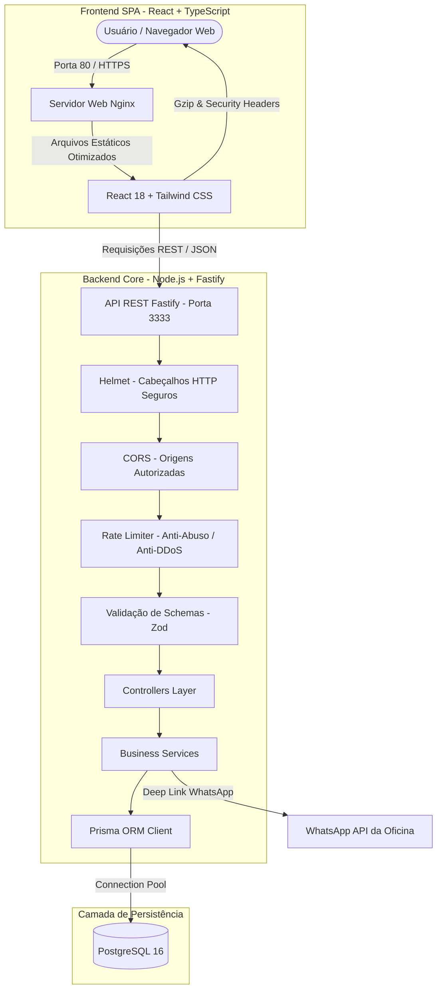

# 🏁 63 Motorsport | High Performance Lab

[](https://nodejs.org/)
[](https://react.dev/)
[](https://www.typescriptlang.org/)
[](https://fastify.dev/)
[](https://tailwindcss.com/)
[](https://www.prisma.io/)
[](https://www.docker.com/)

Plataforma web de apresentação institucional, telemetria de dinamômetro e captação de clientes para a oficina de preparação automotiva de alta performance **63 Motorsport**. Construída com arquitetura full-stack moderna (React + Fastify), tipagem estrita de ponta a ponta e padrões de segurança de nível de produção.

---

## 📌 Sumário
- [Arquitetura do Sistema](#-arquitetura-do-sistema)
- [Stack Tecnológica e Decisões](#-stack-tecnológica-e-decisões)
- [Padrões de Segurança & Produção](#-padrões-de-segurança--produção)
- [Estrutura do Repositório](#-estrutura-do-repositório)
- [Guia de Execução Local](#-guia-de-execução-local)
- [Subida em Produção (Docker Compose)](#-subida-em-produção-docker-compose)
- [Documentação da API REST](#-documentação-da-api-rest)
- [Identidade Visual da Marca](#-identidade-visual-da-marca)

---

## 🏗 Arquitetura do Sistema



---

## 🛠 Stack Tecnológica e Decisões

| Camada | Tecnologia | Motivo da Escolha |
| :--- | :--- | :--- |
| **Frontend** | **React 18 + TypeScript + Vite** | Renderização reativa de alta performance, tipagem estrita e build otimizado com *tree-shaking*. |
| **Estilização** | **Tailwind CSS** | Design system consistente, paleta personalizada sem classes css conflitantes e zero runtime overhead. |
| **Backend** | **Node.js (v22+) + Fastify 5** | Overhead mínimo de latência, suporte nativo a TS e ecossistema modular de plugins de segurança. |
| **Validação** | **Zod** | Validação rigorosa dos contratos de payload na borda da API para proteção contra injeções. |
| **ORM & Banco** | **Prisma 6 + PostgreSQL 16** | Modelagem declarativa, migrações versionadas e consultas tipadas. |
| **Servidor Web** | **Nginx Alpine (Multi-stage)** | Servidor de alta eficiência com compressão Gzip ativa, cache de 1 ano para bundles estáticos e cabeçalhos defensivos. |

---

## 🛡 Padrões de Segurança & Produção

Seguindo as melhores práticas corporativas implementadas no projeto base (ProjectManagementSystem):

1. **Proteção Contra Ataques de Negação de Serviço (Rate Limiting):**
   - `@fastify/rate-limit` global (100 requisições/minuto).
   - Rate limit específico e estrito no endpoint de solicitação de orçamento (`/api/v1/quotes` - máx 10 solicitações/hora por IP) para evitar automação e bots.
2. **Defesa em Camadas com Cabeçalhos HTTP (Helmet & Nginx):**
   - `X-Frame-Options: SAMEORIGIN` (previne ataques de *clickjacking*).
   - `X-Content-Type-Options: nosniff` (impede MIME-type sniffing).
   - `X-XSS-Protection: 1; mode=block` (filtro contra cross-site scripting).
   - `Referrer-Policy: strict-origin-when-cross-origin`.
3. **CORS com Lista Branca Estrita:**
   - Origens permitidas configuráveis dinamicamente via variável de ambiente `CORS_ORIGIN`.
4. **Isolamento de Contêineres:**
   - O Dockerfile do backend roda estritamente sob o usuário sem privilégios (`USER node`), prevenindo escalonamento de privilégios.
5. **Encerramento Limpo (Graceful Shutdown):**
   - Captura dos sinais `SIGINT` e `SIGTERM` para fechamento seguro do pool do banco de dados e finalização de requisições pendentes.
6. **Fallback Gracioso para WhatsApp:**
   - Caso a API esteja em manutenção momentânea, o frontend mantém o fluxo de conversão gerando diretamente o link do WhatsApp com os dados preenchidos.

---

## 📂 Estrutura do Repositório

```text
63Motorsport/
├── .agent/                       # Skills do Antigravity para Design & UI/UX
│   └── skills/
│       ├── ui-ux-pro-max/        # Regras de design visual e conversão
│       ├── antigravity-design-expert/ # Frontend moderno e Tailwind
│       └── motorsport-brand-design/   # Identidade de marca 63 Motorsport
├── backend/                      # API REST em Fastify + TypeScript
│   ├── prisma/                   # Schema relacional e script de seed
│   ├── src/
│   │   ├── controllers/          # Handlers HTTP
│   │   ├── services/             # Regras de negócio e integração
│   │   ├── schemas/              # Validação Zod (Quotes & Projects)
│   │   ├── routes/               # Rotas separadas por domínio
│   │   ├── lib/                  # Singleton Prisma Client
│   │   ├── app.ts                # Fábrica Fastify com plugins e error handler
│   │   └── server.ts             # Entrypoint com Graceful Shutdown
│   ├── Dockerfile                # Multi-stage build com usuário node
│   └── package.json
├── frontend/                     # Aplicação SPA em React + TypeScript + Vite
│   ├── src/
│   │   ├── components/           # Navbar, Hero, DynoTelemetryCard, Services, QuoteModal, etc.
│   │   ├── services/             # Cliente HTTP com fallback resiliente
│   │   ├── types/                # Interfaces TypeScript compartilhadas
│   │   ├── App.tsx               # Orquestrador da aplicação
│   │   └── index.css             # Tailwind + classes de tema automobilístico
│   ├── nginx.conf                # Configuração segura do Nginx para produção
│   ├── Dockerfile                # Multi-stage build (Node -> Nginx Alpine)
│   └── package.json
├── docker-compose.yml            # Orquestração do banco para desenvolvimento local
├── docker-compose.prod.yml       # Orquestração full stack completa para produção
├── .env.example                  # Template com variáveis de ambiente do projeto
└── README.md                     # Documentação geral
```

---

## ⚡ Guia de Execução Local

### Pré-requisitos
- **Node.js** (v20+ instalado)
- **npm** (v10+ instalado)

### 1. Clonar e Configurar Variáveis de Ambiente
```bash
cp .env.example .env
cp backend/.env.example backend/.env
```

### 2. Executar o Backend
```bash
cd backend
npm install
npm run dev
```
A API iniciará em: `http://localhost:3333` (verifique com `http://localhost:3333/health`).

### 3. Executar o Frontend
Em outro terminal:
```bash
cd frontend
npm install
npm run dev
```
O site estará acessível em: `http://localhost:5173`.

---

## 🚀 Subida em Produção (Docker Compose)

Para subir o ambiente completo (Postgres + API Fastify + Frontend Nginx) com rede isolada e reinicialização automática:

```bash
docker compose -f docker-compose.prod.yml up -d --build
```

O site responderá na porta padrão HTTP **80** e a API na porta **3333**.

---

## 📖 Documentação da API REST

| Método | Endpoint | Proteção | Descrição |
| :--- | :--- | :---: | :--- |
| `GET` | `/health` | Aberto | Status operacional, uptime e diagnóstico do banco de dados. |
| `GET` | `/api/v1/projects` | Aberto | Lista projetos de preparação com telemetria (WHP, torque, RPM, mods). |
| `POST` | `/api/v1/quotes` | Rate Limit (10/h) | Registra solicitação de orçamento e gera link direto do WhatsApp. |

### Exemplo de Payload: `POST /api/v1/quotes`
```json
{
  "name": "Gabriel Lemke",
  "phone": "(47) 99999-9999",
  "email": "gabriel@exemplo.com",
  "vehicle": "Golf GTI MK7 2.0 TSI",
  "service": "REMAP_STAGE2",
  "message": "Carro já possui intake R600 e downpipe. Quero acerto no dinamômetro."
}
```

---

## 🎨 Identidade Visual da Marca

* **Asphalt Black** (`#090A0D`): Fundo primário escuro de pista.
* **Carbon Graphite** (`#13151A`): Superfície dos cards de componentes.
* **Gunmetal Gray** (`#262933`): Bordas precisas de instrumentação técnica.
* **Pure Titanium** (`#FFFFFF`): Tipografia de destaque em alto contraste.
* **Tachometer Red** (`#EF4444`): Acento esportivo inspirado em tacômetros de corte e dinamômetros.
